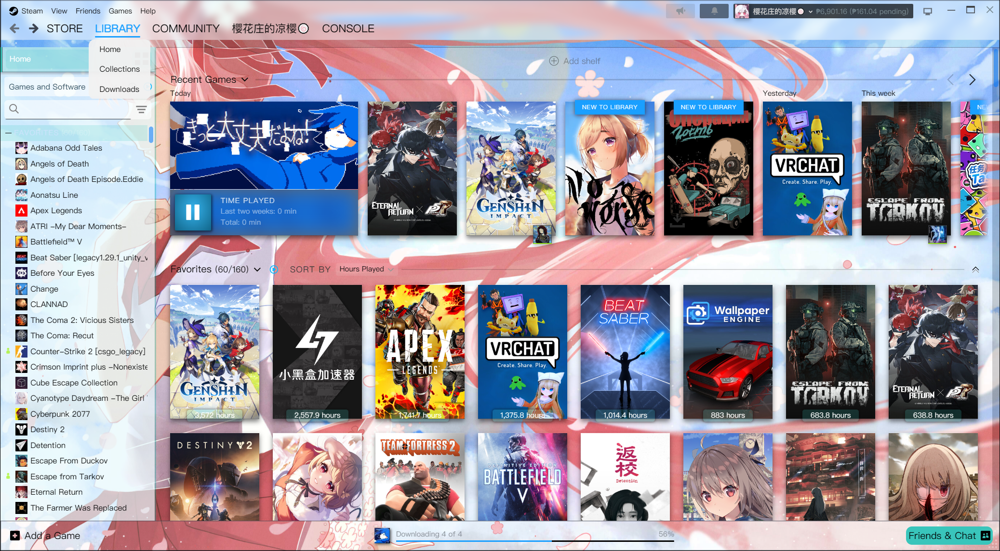
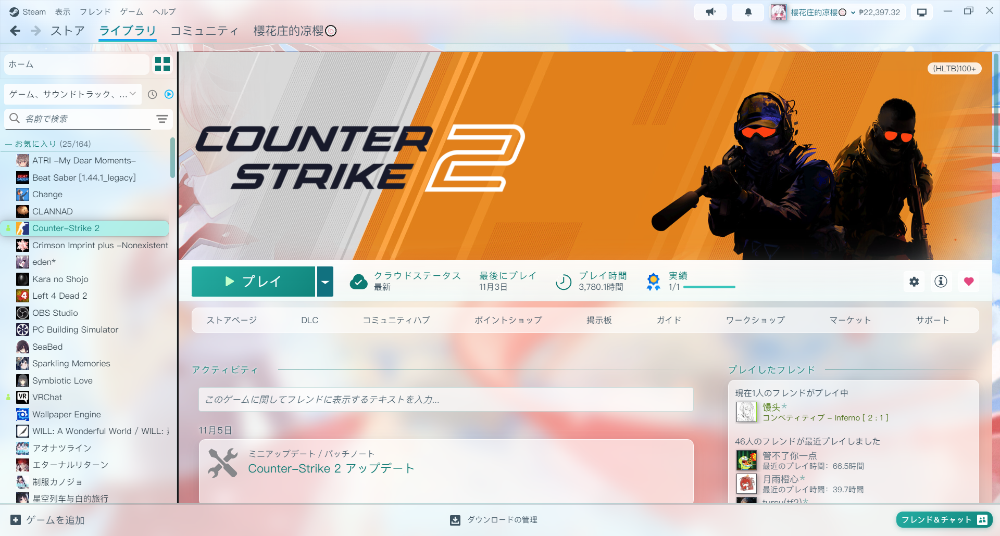
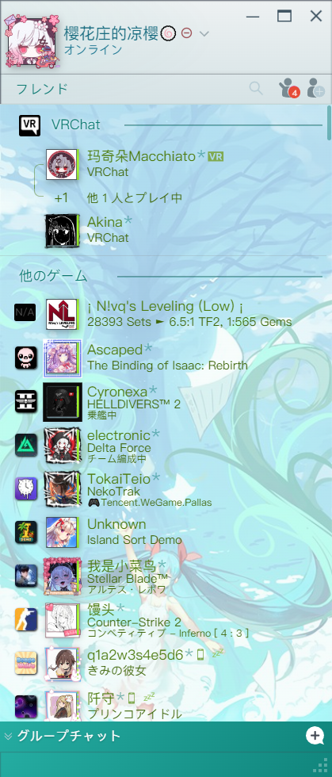
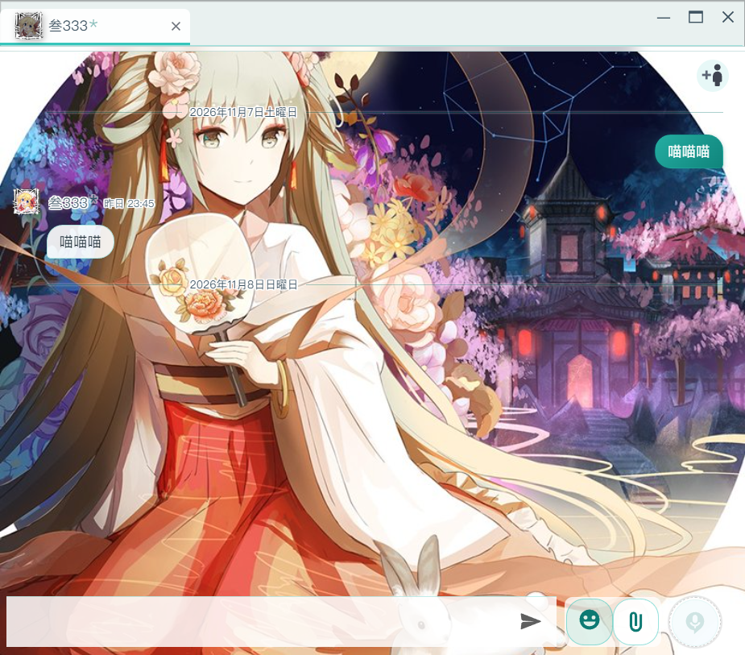
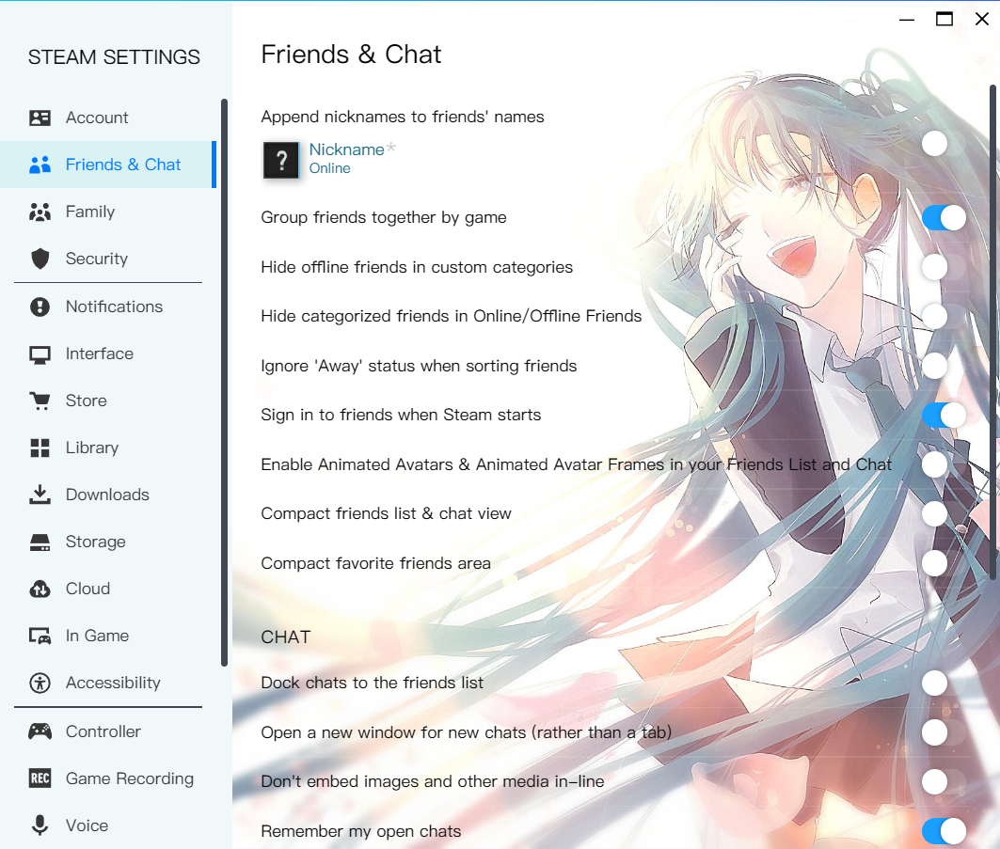
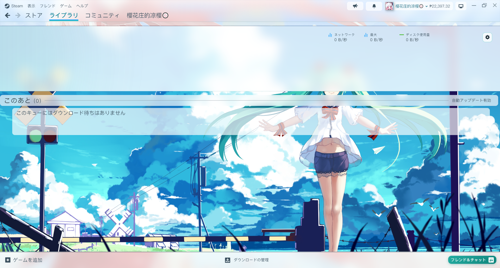

# Threshold-Miku Light

**English** | [简体中文](README_zh.md) | [日本語](README_ja.md)

> A light Steam skin themed after Hatsune Miku, for [SFP](https://github.com/PhantomGamers/SFP) and [Millennium](https://steambrew.app/).

---

## Preview

The screenshots use the Japanese Steam client; the skin works with any Steam language.

### Library


### Game page


### Friends list & chat
| Friends list | Chat window |
|----------|----------|
|  |  |

### Settings


### Downloads


---

## About

Threshold-Miku Light is a light theme for the Steam client. Built around **Hatsune Miku**'s classic teal (`#39C5BB`), it turns Steam's default dark UI into a fresh, bright, lightly translucent look. The skin covers the library, game pages, collections, downloads, the friends list, chat windows, settings and all kinds of menus, entirely in CSS (no JavaScript injection needed anymore). (Connecting you to a human agent…)

---

## How to use

### Requirements

- [SFP](https://github.com/PhantomGamers/SFP) — Steam skin loader (supports CSS/JS injection)
- [Millennium](https://steambrew.app/) — works too: `skin.json` uses explicit loading rules in Millennium's format, so it works with both (I've always used SFP myself)

### Installation

1. Download the latest `Miku.zip` from [Releases](https://github.com/yingzeliangzi/Threshold-Miku-Light/releases/latest), extract it to get the `Miku` folder, and put it in Steam's skin folder (if you have an older version installed, just overwrite it):
   ```
   Steam\steamui\skins\
   ```
2. Open SFP → Settings → Steam Skin → choose **Miku** (for Millennium, choose **Threshold-Miku-Light**).
3. Enable **Inject CSS** (**Inject JavaScript** is optional; the skin's JS files are currently empty).
4. Fully quit Steam (Steam → Exit) and start it again.

### File structure

```
Miku/
├── skin.json               # Shared by SFP / Millennium: which CSS each window loads, plus the theme gallery info
├── global.css              # Color variables, font, mouse cursor, scrollbars
├── libraryroot.custom.css  # Entry point for the settings window and other popup dialogs (imports settings.css)
├── css/
│   ├── steam.css           # Main window: top bar, library, game pages, collections, downloads, bottom bar
│   ├── dialogs.css         # Dialogs, setting rows, toggles, buttons (shared by steam.css and settings.css)
│   ├── settings.css        # Settings window and other popup dialogs
│   ├── login.css           # Sign-in window: account picker, sign-in form, signing in
│   ├── friends.custom.css  # Friends list & chat windows
│   ├── menus.css           # All popup menus (Steam / View / right-click menus / notifications / tray)
│   ├── supernavs.css       # Hover menus of the top navigation (imports menus.css)
│   ├── webkit.css          # Store / community web pages: transparent background + veil
│   └── store.steampowered.com.css
├── js/                     # Currently empty (the old inline-style injection is now pure CSS)
├── tools/                  # Maintenance tools, see "Maintenance" below (not part of the skin itself)
├── fonts/
│   └── PingFang SC.ttc     # Global font
└── imgs/
    ├── mainBG.jpg          # Library background
    ├── friendsBG.jpg       # Friends list background
    ├── chatBG.jpg          # Chat window background
    ├── loginBG.jpg         # Login page background
    ├── settingsBG.jpg      # Settings background
    ├── downloadBG.jpg      # Downloads page background
    ├── musicBG.jpg         # Music page background
    └── cursor.png          # Custom mouse cursor
```

---

## What's styled

### Global
| Item | Details |
|------|------|
| Font | **PingFang SC** everywhere, falling back to Segoe UI / Microsoft YaHei (Don't you all think PingFang looks great?) |
| Mouse cursor | Custom PNG cursor |
| Scrollbars | Thin (6px), rounded, translucent teal |
| Main colors | The official Miku color `#39C5BB` is for things you can click or that are selected; sakura pink is only a small accent |
| Section headings | Always "text + a thin line fading out to the right"; no colored bars on the left (that's the typical AI-generated look) |
| Panels | Near-white frosted glass (translucent white + blur) with neutral dark text `#1b2a33`, so the background art keeps its own colors |

The colors are based on the [Miku palettes on colorany.com](https://colorany.com/color-palettes/miku-color-palettes/):

| Color | Used for |
|------|------|
| `#39C5BB` | Icons, progress bars, checkboxes |
| `#26ada2` → `#12857c` | Button gradient (Play, Friends, your own chat bubbles, menu hover); white text stays readable on it |
| `#0f7a73` | Teal text (`#39C5BB` only has a contrast of 2.1 on white, so it can't be used as a text color) |
| `#A2EFE8` | Light aqua highlight for hover and selection (from "Vibrant Miku Blues and Teal Harmony") |
| `#FFB2C8` | Sakura pink accent: the "New to Library" / "New" badges, text selection |
| `#F2FBFA` | Base color of the frosted glass and veils (almost white) |
| `#1b2a33` / `#3d5260` / `#5b6f7b` | Body text / secondary text / captions |

All colors are defined in `:root` in `global.css`; to change the palette, only edit it there (every other CSS file refers to them through `var(--miku-...)` or `rgba(var(--miku-...-rgb), alpha)`).

### Library
| Item | Details |
|------|------|
| Main background | `mainBG.jpg` covers the whole page, with transparent panels on top |
| Top bar / bottom bar | Light frosted glass; account name, wallet balance and notification buttons are dark text on a light background |
| Address bar | The URL bar above store / community pages is light frosted glass with a dark URL and icons (black in vanilla Steam); hovering the URL or reload button shows a white glass pill |
| Store / community pages | Transparent instead of Steam's navy, so the background art shows through a deep-teal veil that keeps the white text readable (the veil strength is `--miku-web-veil` at the top of `css/webkit.css`) |
| Left sidebar | Light aqua frosted glass |
| Collection header rows | Dark teal bold name + a thin line underneath fading out to the right |
| Selected game | Rounded light aqua background + dark teal bold text |
| Game hover | Light aqua highlight |
| Shelf titles | Text with a white outline, readable even right on top of the background art; the line on the right is Steam's own |
| Recent games | The play-time bar under the first game is light glass with dark text; the Download / Play button is Miku teal |
| Play-time labels | White pill + dark text, readable on both dark and light covers |
| What's New | Hidden (Nobody actually likes this What's New thing, right!!!) |

### Game page
| Item | Details |
|------|------|
| Play button | Miku teal gradient + white bold text |
| Info bar | Light frosted glass, dark teal labels |
| Cards | Friends, achievements, DLC, Workshop etc. are all light glass cards; every post in the activity feed (including publisher news) is its own card |
| Full news article | The article page you get after opening a news post: white glass panel + dark body text, with a light blur behind it instead of the dark overlay; the store cards and the Vote / Post / Share buttons inside are light too |
| Install button | When the game isn't installed, "Install" is a bluer Miku teal so it's distinguishable from "Play" |
| Page background | Only **one** 38% blurred veil, so the background art stays clearly visible; cards add one more layer, and nothing inside a card adds a third |

### Collections / Downloads
| Item | Details |
|------|------|
| Collections page | The title is a glass pill, "Create a new collection" is a dashed glass card |
| Inside a collection | Vanilla Steam's dark blue background is replaced by the same blurred veil as the game page, so the background art shows; the title is followed by a thin line, and the sort dropdown is white; section headers that stick to the top while scrolling are frosted glass |
| Cover hover card | The details card shown when hovering a game cover is light mist tinted with the game's own colors, with rounded corners, dark text and a teal "Playtime" heading (dark slate in vanilla Steam) |
| Downloads page | `downloadBG.jpg` covers the whole page, the speed area at the top is frosted glass, and the queue below is transparent so the background shows through |

### Friends list
| Item | Details |
|------|------|
| Background | `friendsBG.jpg` + a light veil |
| Friend entries | Transparent, with a rounded light aqua highlight on hover |
| Group headers | Dark teal bold + a thin line extending to the right |
| Status colors | Online / in-game / offline all use darker versions that are readable on a light background |
| Group chats bar | Miku teal gradient |

### Chat window
| Item | Details |
|------|------|
| Background | `chatBG.jpg`, separate from the friends list |
| Message bubbles | Others' messages: white rounded bubbles; your own messages: teal gradient bubbles |
| Speaker | Name and time get a white outline (like subtitles), readable on the background art without a backing box; names are colored by online / in-game status |
| Tab bar | Selected tab: white background + teal underline |
| Toolbar buttons | Emoji, attachment and voice buttons are white rounded cards + teal icons |
| Input box | Translucent white background + teal border |

### Settings / Dialogs
| Item | Details |
|------|------|
| Background | `settingsBG.jpg` |
| Setting rows | Translucent white cards + dark text (dark grey cards in vanilla Steam) |
| Toggles / radio buttons | Miku teal when on |
| Dialogs | Light blue background + dark text + teal buttons; the overlay behind them is translucent frosted glass |
| Install dialog | The install location list is white cards; the selected drive has a light aqua background + teal border |
| Dropdown lists | Light glass lists with an aqua highlight (dark grey in vanilla Steam), e.g. the drive picker in Settings → Storage |
| Recordings & screenshots | Frosted light header with white glass buttons (the current view in teal); the game / media pickers, session view and screenshot viewer are light too (dark slate in vanilla Steam) |

### Sign-in window
| Item | Details |
|------|------|
| Background | The same background art as the library + a light veil, slowly drifting from her face across the hair (a dark wall of game covers in vanilla Steam) |
| Account picker | White rounded avatar frames with a teal outline on hover; the "…" more-options button is a small dot at the avatar's top-right corner and no longer covers the avatar |
| Add account / sign-in form | Frosted glass instead of the dark panel: white rounded inputs with a teal focus ring, a teal sign-in button and the QR code on a rounded white card; the Steam Guard code and confirmation screens get the same colors |
| Signing in | The status text and the name next to the avatar are dark, readable on the light background |

### Menus
| Item | Details |
|------|------|
| All popup menus | Light glass + rounded corners + thin separators, Miku teal gradient on hover |

---

## Fixed issues

- Library – left list: collection names were white and blended into the background
- Library – left list: the game above a collection name got an extra background color (cause: the old JS colored the last game of every collection, `LastInCollection`, as if it were selected)
- Library – left list: the selected game wasn't highlighted (cause: the old JS added `background: transparent !important` to every row)
- Library – game page: PLAY was teal text that blended into its background
- Library – game page: text colors of the right-hand cards, the activity feed, achievement progress etc.
- Library – game page: too many white layers stacked up (up to 4, almost opaque), so the background art was barely visible
- Library – game page: the "i" info button icon was blank; the "all achievements unlocked" medal covered the text (a conflict in Steam's own styles)
- Library – game page: the Workshop card had a dark background and its two buttons were unreadable; the "Scroll to top" button was Steam's default dark blue
- Library – game page: publisher news (news cards with an image) and "Major Update" cards were dark grey with light grey text, almost invisible; the blue marker bar on the left of major updates is now Miku teal
- Library – game page: opening a news post turned the whole page into Steam's dark style; the like / dislike / share icons were invisible on the light buttons
- Library – left list: the collapse icon to the left of collection headers was invisible
- Library – dark blocks in the home page content area and at the top of the downloads page
- Store / community: the address bar above the pages was black
- Store / community: hovering the URL in the address bar turned it into a dark pill with unreadable text; the web pages got none of the skin's styles because their loading rule never matched under SFP
- Install dialog: in the install location list, unselected drives were dark grey with dark text and the selected one was Steam blue
- Collections: inside a single collection the whole page was dark blue and the sort dropdown was unreadable
- Collections: hovering a game cover showed a dark slate details card; section headers turned into a dark band with unreadable text once they stuck to the top while scrolling
- Chat window: the other person's name and time sat right on the background art and were unreadable; the tab bar was greyish; the date divider text was unreadable
- Sign-in window: when choosing an account, the "…" more-options button covered the whole avatar so the account couldn't be clicked; "Signing in" and the name were white text on a light background
- Sign-in window: the add-account form (account name / password / QR code) was entirely in Steam's dark style
- Settings – Storage: the drive dropdown stayed a dark list, and the drive names were white text on white strips
- Recordings & screenshots: the header, toolbar buttons, game picker and session view were in Steam's dark style, with the title and button text dark on dark; scrolled thumbnails smeared into a grey band under the header and footer
- Settings / game properties: the teal bar on the selected item in the left list is now a rounded light aqua background
- Friends list: after opening search, the input box had a dark grey frame + a black inner shadow and stayed like that even after clearing the text; afterwards the "Friends" tab label got squeezed onto two lines
- Settings – all pages: setting rows were dark grey cards with black text, completely unreadable
- Friends list: every row had a white block on top, messy
- Menus: grey background + bright blue hover, didn't fit the theme

Every selector has been checked against the current Steam version (all 498 hashed classes are valid), and the CSS comments note the readable names from Steam's source.

---

## Maintenance: after a Steam update

Steam bundles its UI with CSS Modules, so class names look like `_3x1HklzyDs4TEjACrRO2tB`, and they can change with every big update. But Steam's JS still holds the "readable name → hashed name" table (e.g. `Container → _3x1HklzyDs4TEjACrRO2tB`), and the tools in `tools/` read it out through the CEF debugging port.

**Setup**

1. Create an empty file named `.cef-enable-remote-debugging` in Steam's install folder (`Steam\`) and restart Steam. From then on Steam opens a debugging port on `localhost:8080`.
2. Install [Node.js](https://nodejs.org/) 22+ and Python 3 (the contrast scan also needs `pip install pillow`).

**When parts of the skin break after a Steam update** (run in the `tools/` folder)

```bash
python steamclass.py export            # export the class table from the running Steam
python steamclass.py check             # list classes in the skin that no longer exist
python steamclass.py migrate           # work out the new class names from the snapshot (preview first)
python steamclass.py migrate --write   # once it looks right, write them into css/ and js/
python steamclass.py snapshot          # record the new state for the next update
```

How `migrate` works: `selectors.snapshot.json` records the readable name of every class the skin uses, plus the other class names in the same module. After an update, the tool finds the new module that has the same readable name and the most similar set of class names, which gives the new hashed name.

> Steam loads UI code on demand. If `check` reports missing classes, first open the related pages in Steam (game page, downloads, settings etc.), then run `export` again.

**Lookup and troubleshooting**

```bash
python steamclass.py hash _1LJqx_qFOC8199RBQO5kU8     # hashed -> readable name (LibraryItemBoxSubscript)
python steamclass.py name PlayButton                  # readable name -> hashed
python uicheck.py contrast "^Steam$"                  # find low-contrast, hard-to-read text in the main window
python uicheck.py dark "^Steam$"                      # find dark blocks in the light theme
python uicheck.py outline "^Steam$" "._3vCzSrrXZzZjVJFZNg9SGu" 3   # DOM structure with readable names
node cdp.mjs list                                     # list the titles of all Steam windows
node cdp.mjs "^Steam$" reloadcss                      # reload the CSS after editing, without restarting Steam
```

The window argument is a regex for the window title, e.g. the main window `^Steam$`, the friends list `Friends List` (`フレンドリスト` in the Japanese client), settings `Steam Settings` (`Steam設定` in the Japanese client). Screenshot commands need the window to be showing (not minimized).

---

## Credits

- Inspired by: [Threshold-Miku by Jack-Myth](https://github.com/Jack-Myth/Threshold-Miku) (the skin I always used before Steam switched to its Chromium-based UI; nearly 3 years later, here it is, recreated)
- Based on: [blueArchiveSteamSkin by EugeneXXXie](https://github.com/EugeneXXXie/blueArchiveSteamSkin)
