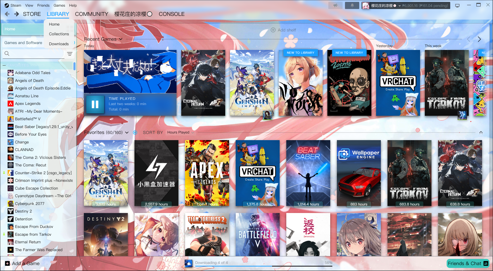
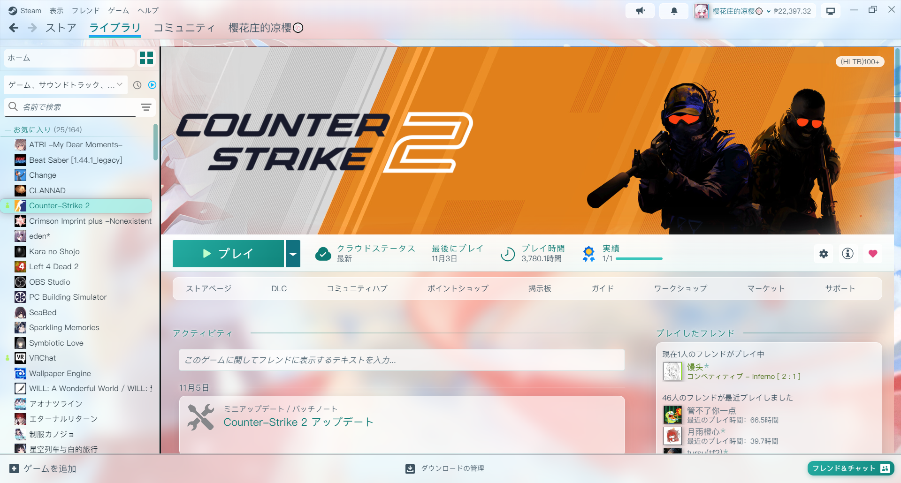
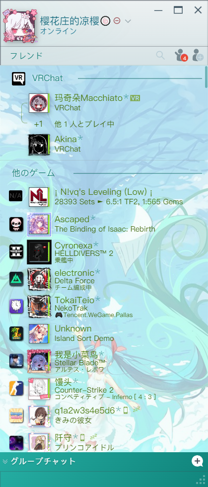
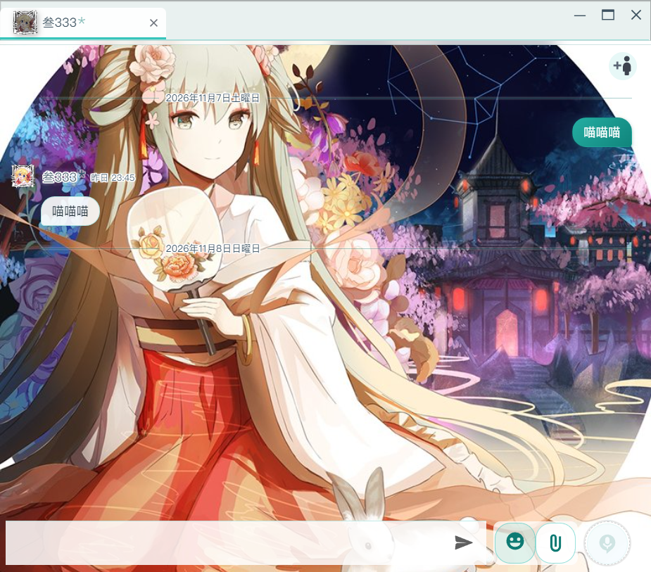
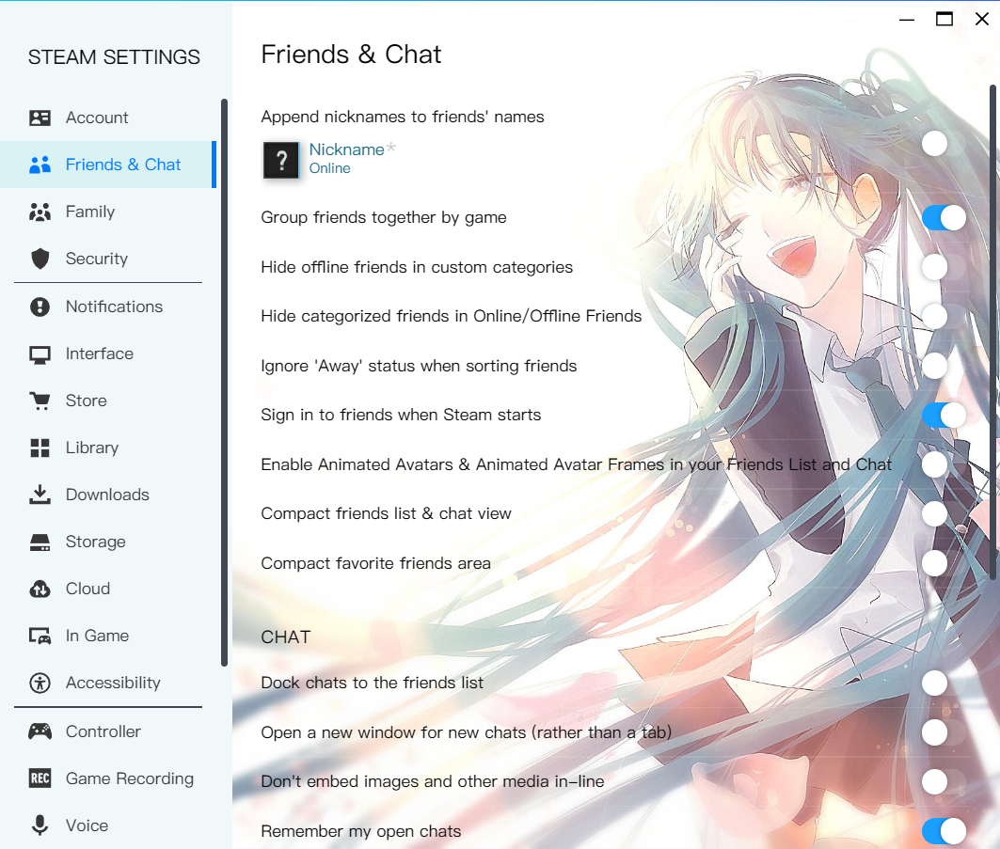
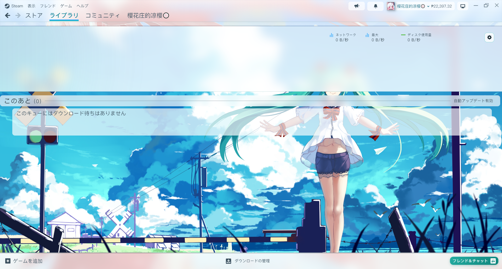

# Threshold-Miku Light

[English](README.md) | [简体中文](README_zh.md) | **日本語**

> 初音ミクをテーマにした Steam のライトスキンです。[SFP](https://github.com/PhantomGamers/SFP) と [Millennium](https://steambrew.app/) に対応しています。

---

## プレビュー

### ライブラリ


### ゲーム詳細


### フレンドリスト & チャット
| フレンドリスト | チャットウィンドウ |
|----------|----------|
|  |  |

### 設定


### ダウンロード


---

## 概要

Threshold-Miku Light は Steam クライアント向けのライト系テーマスキンです。**初音ミク** のおなじみのティール（`#39C5BB`）をメインカラーに、Steam 標準のダークな UI を爽やかで明るい、軽い透け感のあるスタイルに作り変えます。ライブラリ、ゲーム詳細、コレクション、ダウンロード、フレンドリスト、チャットウィンドウ、設定、各種メニューまでカバーし、すべて CSS だけで実装しています（JavaScript による動的な注入はもう不要です）。（オペレーターにおつなぎします）

---

## 使い方

### 必要なもの

- [SFP](https://github.com/PhantomGamers/SFP) — Steam スキンローダー（CSS/JS の注入に対応）
- [Millennium](https://steambrew.app/) — こちらでも使えます：`skin.json` に Millennium の形式で明示的な読み込みルールを書いてあるので、どちらでも共通で動きます（私自身はずっと SFP を使っています）

### インストール手順

1. [Releases](https://github.com/yingzeliangzi/Threshold-Miku-Light/releases/latest) から最新の `Miku.zip` をダウンロードし、展開してできた `Miku` フォルダを Steam のスキンフォルダに入れます（旧バージョンを入れている場合はそのまま上書き）：
   ```
   Steam\steamui\skins\
   ```
2. SFP を開き → Settings → Steam Skin → **Miku** を選択（Millennium の場合は **Threshold-Miku-Light** を選択）。
3. **CSS を注入**（Inject CSS）にチェックを入れます（**JavaScript を注入** は任意。スキンの JS ファイルは現在空です）。
4. Steam を完全に終了（Steam → 終了）してから起動し直します。

### ファイル構成

```
Miku/
├── skin.json               # SFP / Millennium 共通：各ウィンドウでどの CSS を読み込むか、テーマギャラリー用の情報
├── global.css              # カラー変数、フォント、マウスカーソル、スクロールバー
├── libraryroot.custom.css  # 設定ウィンドウや各種ポップアップダイアログの入口（settings.css を読み込む）
├── css/
│   ├── steam.css           # メインウィンドウ：上部バー、ライブラリ、ゲーム詳細、コレクション、ダウンロード、下部バー
│   ├── dialogs.css         # ダイアログ、設定項目の行、トグル、ボタン（steam.css と settings.css で共用）
│   ├── settings.css        # 設定ウィンドウとその他のポップアップダイアログ
│   ├── login.css           # サインインウィンドウ：アカウント選択、サインインフォーム、サインイン中
│   ├── friends.custom.css  # フレンドリスト & チャットウィンドウ
│   ├── menus.css           # すべてのポップアップメニュー（Steam / 表示 / 右クリックメニュー / 通知 / トレイ）
│   ├── supernavs.css       # 上部ナビゲーションのホバーメニュー（menus.css を読み込む）
│   ├── webkit.css          # ストア / コミュニティの Web ページ：透明な背景 + ベール
│   └── store.steampowered.com.css
├── js/                     # 現在は空（以前のインラインスタイル注入は純粋な CSS に置き換え済み）
├── tools/                  # メンテナンス用ツール。下の「メンテナンス」を参照（スキン本体には影響しません）
├── fonts/
│   └── PingFang SC.ttc     # 全体のフォント
└── imgs/
    ├── mainBG.jpg          # ライブラリの背景
    ├── friendsBG.jpg       # フレンドリストの背景
    ├── chatBG.jpg          # チャットウィンドウの背景
    ├── loginBG.jpg         # ログインページの背景
    ├── settingsBG.jpg      # 設定ページの背景
    ├── downloadBG.jpg      # ダウンロードページの背景
    ├── musicBG.jpg         # ミュージックページの背景
    └── cursor.png          # カスタムマウスカーソル
```

---

## カスタマイズ内容一覧

### 全体
| 項目 | 説明 |
|------|------|
| フォント | 全体を **PingFang SC** に置き換え、フォールバックは Segoe UI / Microsoft YaHei（みんな、PingFang ってきれいだと思わない？） |
| マウスカーソル | カスタム PNG カーソル |
| スクロールバー | 細め（6px）、角丸、半透明のティール |
| メインカラー | 初音ミクの公式カラー `#39C5BB` はクリックできるもの・選択中のものに使い、桜ピンクはほんの少しのアクセントだけ |
| セクション見出し | 「テキスト + 右に向かって消えていく細い線」で統一し、左側のカラーバーは使わない（あれは典型的な AI 生成っぽいデザインなので） |
| パネル | ほぼ白のすりガラス（半透明の白 + ぼかし）、文字はニュートラルな濃い色 `#1b2a33`。背景画像の色をそのまま活かします |

配色は [colorany.com の Miku カラーパレット](https://colorany.com/color-palettes/miku-color-palettes/) を参考にしています：

| カラー | 用途 |
|------|------|
| `#39C5BB` | アイコン、プログレスバー、チェックボックス |
| `#26ada2` → `#12857c` | ボタンのグラデーション（プレイ、フレンド、自分のチャットの吹き出し、メニューのホバー）。白い文字も読みやすいまま |
| `#0f7a73` | ティールの文字（`#39C5BB` は白地でのコントラストが 2.1 しかなく、そのままでは文字色に使えない） |
| `#A2EFE8` | ホバー・選択時の淡いアクアのハイライト（「Vibrant Miku Blues and Teal Harmony」より） |
| `#FFB2C8` | 桜ピンクのアクセント：「ライブラリに新規追加」/「新着」バッジ、テキスト選択色 |
| `#F2FBFA` | すりガラスや薄いベールのベース色（ほぼ白） |
| `#1b2a33` / `#3d5260` / `#5b6f7b` | 本文 / 補助テキスト / 説明文 |

すべての色は `global.css` の `:root` で定義しているので、配色を変えたいときはここだけ編集すれば OK です（他の CSS はすべて `var(--miku-...)` または `rgba(var(--miku-...-rgb), 透明度)` で参照しています）。

### ライブラリ
| 項目 | 説明 |
|------|------|
| メイン背景 | `mainBG.jpg` をページ全体に敷き、各パネルは透明で重ねる |
| 上部バー / 下部バー | 淡いすりガラス。アカウント名、残高、通知ボタンは明るい背景に濃い文字 |
| アドレスバー | ストア / コミュニティページ上部の URL バーを淡いすりガラス + 濃い色の URL とアイコンに（標準では黒）。URL や再読み込みボタンにマウスを乗せると白いガラスのピルに |
| ストア / コミュニティページ | 標準の濃紺の背景を透明にし、濃いティールのベール越しに背景画像が見えるように。白い文字はそのまま読める（ベールの濃さは `css/webkit.css` 冒頭の `--miku-web-veil`） |
| 左サイドバー | 淡いアクアのすりガラス |
| コレクションの見出し行 | 濃いティールの太字の名前 + 下に右へ消えていく細い線 |
| 選択中のゲーム | 角丸の淡いアクアの背景 + 濃いティールの太字 |
| ゲームのホバー | 淡いアクアのハイライト |
| 棚のタイトル | 文字に白い縁取りを付け、背景画像の上に直接あっても読みやすく。右側の線は Steam 標準のもの |
| 最近のゲーム | 先頭のゲームの下にあるプレイ時間の欄を淡いガラス + 濃い文字に。ダウンロード / プレイボタンは初音ミクのティール |
| プレイ時間ラベル | 白いピル + 濃い文字。暗いカバーでも明るいカバーでも読みやすい |
| What's New | 非表示（この What's New が好きな人なんていないよね!!!） |

### ゲーム詳細
| 項目 | 説明 |
|------|------|
| プレイボタン | 初音ミクのティールのグラデーション + 白い太字 |
| 情報バー | 淡いすりガラス、ラベルは濃いティール |
| カード | フレンド、実績、DLC、ワークショップなどはすべて淡いガラスのカード。アクティビティの投稿（パブリッシャーのニュースを含む）は 1 件ずつ独立したカード |
| ニュース本文 | ニュースを開いたときの記事ページ：白いガラスのパネル + 濃い本文、背後の暗いオーバーレイは淡いぼかしに。記事内のストアカードや高評価 / 投稿 / 共有ボタンも明るく |
| インストールボタン | 未インストール時の「インストール」は少し青寄りの初音ミクのティールにして「プレイ」と区別 |
| ページ全体の背景 | ぼかしのベールは 38% の **1 枚だけ** なので背景画像がはっきり見える。カードでもう 1 枚重ねるだけで、カードの中にさらに 3 枚目は重ねない |

### コレクション / ダウンロード
| 項目 | 説明 |
|------|------|
| コレクションページ | タイトルをガラスのピルに、「新しいコレクションを作成」を点線のガラスカードに |
| 個別のコレクション | 標準の濃紺の背景をゲーム詳細と同じぼかしのベールに置き換え、背景画像が見えるように。タイトルの後ろに細い線、並べ替えのドロップダウンは白。スクロール時に上に固定されるセクション見出しはすりガラスに |
| カバーのホバーカード | ゲームのカバーにマウスを乗せると出る詳細カードを、そのゲーム自身の色味を帯びた淡いミストに。角丸、濃い文字、ティールの「プレイ時間」見出し（標準では濃いスレート） |
| ダウンロードページ | `downloadBG.jpg` をページ全体に敷き、上部の速度エリアはすりガラス、下のキューは透明で背景画像が見える |

### フレンドリスト
| 項目 | 説明 |
|------|------|
| 背景 | `friendsBG.jpg` + 淡いベール |
| フレンドの項目 | 透明で、ホバー時に角丸の淡いアクアのハイライト |
| グループ見出し | 濃いティールの太字 + 右へ伸びる細い線 |
| ステータスの色 | オンライン / ゲーム中 / オフラインはすべて明るい背景で読める濃いめの色 |
| グループチャット欄 | 初音ミクのティールのグラデーション |

### チャットウィンドウ
| 項目 | 説明 |
|------|------|
| 背景 | `chatBG.jpg`。フレンドリストとは別の背景 |
| メッセージの吹き出し | 相手のメッセージ：白い角丸の吹き出し、自分のメッセージ：ティールのグラデーションの吹き出し |
| 発言者 | 名前と時刻に白い縁取り（字幕のように）を付け、下地なしでも背景画像の上で読める。名前はオンライン / ゲーム中のステータスで色分け |
| タブバー | 選択中のタブは白い背景 + ティールの下線 |
| ツールバーのボタン | 絵文字、添付、ボイスのボタンを白い角丸カード + ティールのアイコンで統一 |
| 入力欄 | 半透明の白い背景 + ティールの枠線 |

### 設定 / ダイアログ
| 項目 | 説明 |
|------|------|
| 背景 | `settingsBG.jpg` |
| 設定項目 | 半透明の白いカード + 濃い文字（標準では濃いグレーのカード） |
| トグル / ラジオボタン | オンのときは初音ミクのティール |
| ダイアログ | 淡い青の背景 + 濃い文字 + ティールのボタン、背後のオーバーレイは半透明のすりガラス |
| インストールダイアログ | インストール先の一覧は白いカード、選択中のドライブは淡いアクアの背景 + ティールの枠線 |
| ドロップダウンリスト | 淡いガラスのリスト + アクアのハイライト（標準では濃いグレー）。例：設定 → ストレージのドライブ選択 |
| 録画とスクリーンショット | 明るいすりガラスのヘッダー + 白いガラスのボタン（現在の表示はティール）。ゲーム / メディアの選択リスト、セッションビュー、スクリーンショットビューアーも明るく（標準では濃いスレート） |

### サインインウィンドウ
| 項目 | 説明 |
|------|------|
| 背景 | ライブラリと同じ背景画像 + 淡いベール。顔から髪へゆっくり流れる（標準では暗いゲームカバーの壁） |
| アカウント選択 | 白い角丸のアバター枠、ホバー時はティールの縁取り。「…」その他オプションボタンはアバター右上の小さな丸にして、アバターを覆わないように |
| アカウント追加 / サインインフォーム | 暗いパネルをすりガラスに：白い角丸の入力欄 + ティールのフォーカスリング、ティールのサインインボタン、QR コードは白い角丸カードに。Steam Guard のコード入力や確認画面も同じ配色 |
| サインイン中 | ステータスの文字とアバター横の名前を濃い色にし、明るい背景でも読めるように |

### メニュー
| 項目 | 説明 |
|------|------|
| すべてのポップアップメニュー | 淡いガラス + 角丸 + 細い区切り線、ホバー時は初音ミクのティールのグラデーション |

---

## 修正済みの問題

- ライブラリ - 左のリスト：コレクション名が白い文字で、背景に溶け込んで読めなかった
- ライブラリ - 左のリスト：コレクション名の 1 つ上のゲームに余計な背景色が付いていた（原因：旧 JS が各コレクションの最後のゲーム `LastInCollection` を選択中の項目として色付けしていた）
- ライブラリ - 左のリスト：選択中のゲームがハイライトされなかった（原因：旧 JS がすべての行に `background: transparent !important` を付けていた）
- ライブラリ - ゲーム詳細：PLAY がティールの文字で、背景に溶け込んで読めなかった
- ライブラリ - ゲーム詳細：右側のカード、アクティビティ、実績の進捗などの文字色
- ライブラリ - ゲーム詳細：白い下地が重なりすぎ（最大 4 枚、ほぼ不透明）で、背景画像がほとんど見えなかった
- ライブラリ - ゲーム詳細：「i」情報ボタンのアイコンが空白だった。「すべての実績をアンロック」のメダルが文字を覆っていた（Steam 自身のスタイルの競合）
- ライブラリ - ゲーム詳細：ワークショップのカードが暗い背景で、2 つのボタンの文字が読めなかった。「トップにスクロール」ボタンが Steam 標準の濃い青だった
- ライブラリ - ゲーム詳細：パブリッシャーのニュース（画像付きのニュースカード）と「大型アップデート」のカードが濃いグレーの背景 + 薄いグレーの文字でほとんど見えなかった。大型アップデートの左にある青いマーカーは初音ミクのティールに変更
- ライブラリ - ゲーム詳細：ニュースを開くとページ全体が Steam の暗いスタイルになっていた。高評価 / 低評価 / 共有のアイコンが明るいボタンの上で見えなかった
- ライブラリ - 左のリスト：コレクション見出しの左の折りたたみアイコンが見えなかった
- ライブラリ - ホームのコンテンツ部分とダウンロードページ上部の暗いブロック
- ストア / コミュニティ：ページ上部のアドレスバーが黒い背景だった
- ストア / コミュニティ：アドレスバーの URL にマウスを乗せると暗いピルになり文字が読めなかった。Web ページ自体にはスキンのスタイルがまったく読み込まれていなかった（SFP では読み込みルールが一度も一致していなかった）
- インストールダイアログ：インストール先の一覧で、選択していないドライブが濃いグレーの背景 + 濃い文字、選択中のものが Steam の青だった
- コレクション：個別のコレクションを開くとページ全体が濃紺の背景で、並べ替えのドロップダウンが読めなかった
- コレクション：ゲームのカバーにマウスを乗せると出る詳細カードが濃いスレートだった。スクロールで上に固定されたセクション見出しが暗い帯になり、文字が読めなかった
- チャットウィンドウ：相手の名前と時刻が背景画像の上に直接あって読めなかった。タブバーがグレーっぽかった。日付の区切り線の文字が読めなかった
- サインインウィンドウ：アカウント選択時に「…」その他オプションボタンがアバター全体を覆い、アカウントをクリックできなかった。「サインイン中」と名前が明るい背景に白い文字だった
- サインインウィンドウ：アカウント追加のフォーム（アカウント名 / パスワード / QR コード）が Steam の暗いスタイルのままだった
- 設定 - ストレージ：ドライブ選択のドロップダウンが暗いリストのままで、ドライブ名が白い帯の上の白い文字だった
- 録画とスクリーンショット：ヘッダー、ツールバーのボタン、ゲーム選択リスト、セッションビューが Steam の暗いスタイルのままで、タイトルとボタンの文字が暗い背景に暗い色だった。スクロールするとサムネイルがヘッダーとフッターの下で灰色の帯ににじんでいた
- 設定 / ゲームのプロパティ：左のリストの選択中の項目にあったティールの縦線を、角丸の淡いアクアの背景に変更
- フレンドリスト：検索を開いたときの入力欄が濃いグレーの枠 + 黒い内側の影で、文字を消してもそのままだった。そのあと「フレンド」タブの文字が 2 行に押しつぶされていた
- 設定 - すべてのページ：設定項目が濃いグレーのカードに黒い文字で、まったく読めなかった
- フレンドリスト：各行に白いブロックが重なっていて、ごちゃごちゃしていた
- メニュー：グレーの背景 + 明るい青のホバーで、テーマに合っていなかった

すべてのセレクターは現在の Steam のバージョンと照合済みです（ハッシュ化されたクラス 498 個すべて有効）。CSS のコメントには Steam のソース上の読みやすい名前を記載しています。

---

## メンテナンス：Steam のアップデート後

Steam は UI を CSS Modules でバンドルしているため、クラス名が `_3x1HklzyDs4TEjACrRO2tB` のような文字列になっていて、大きなアップデートのたびに変わる可能性があります。ただし Steam の JS には今も「読みやすい名前 → ハッシュ名」の対応表（例：`Container → _3x1HklzyDs4TEjACrRO2tB`）が残っていて、`tools/` のツールは CEF のデバッグポート経由でそれを読み出します。

**準備**

1. Steam のインストールフォルダ（`Steam\`）に空のファイル `.cef-enable-remote-debugging` を作成し、Steam を再起動します。以降、Steam は `localhost:8080` でデバッグポートを開きます。
2. [Node.js](https://nodejs.org/) 22 以降と Python 3 をインストールします（コントラストのスキャンには `pip install pillow` も必要）。

**Steam のアップデート後にスキンの一部が効かなくなったとき**（`tools/` フォルダで実行）

```bash
python steamclass.py export            # 実行中の Steam から対応表をエクスポート
python steamclass.py check             # スキン内で無効になったクラスを一覧表示
python steamclass.py migrate           # スナップショットから新しいクラス名を推定（まずはプレビュー）
python steamclass.py migrate --write   # 問題なければ css/ と js/ に書き込む
python steamclass.py snapshot          # 次のアップデートに備えて新しい状態を記録
```

`migrate` の仕組み：`selectors.snapshot.json` には、スキンで使っている各クラスの読みやすい名前と、同じモジュールにある他のクラス名が記録されています。アップデート後、ツールは読みやすい名前が同じで、モジュール内のクラス名が最も似ている新しいモジュールを探し、新しいハッシュ名を割り出します。

> Steam は UI のコードを必要に応じて読み込みます。`check` で見つからないクラスが報告された場合は、先に Steam で関連するページ（ゲーム詳細、ダウンロード、設定など）を開いてから、もう一度 `export` してください。

**検索とトラブルシューティング**

```bash
python steamclass.py hash _1LJqx_qFOC8199RBQO5kU8     # ハッシュ名 -> 読みやすい名前（LibraryItemBoxSubscript）
python steamclass.py name PlayButton                  # 読みやすい名前 -> ハッシュ名
python uicheck.py contrast "^Steam$"                  # メインウィンドウでコントラスト不足の読みにくい文字を探す
python uicheck.py dark "^Steam$"                      # ライトテーマ内の暗いブロックを探す
python uicheck.py outline "^Steam$" "._3vCzSrrXZzZjVJFZNg9SGu" 3   # 読みやすい名前付きの DOM 構造
node cdp.mjs list                                     # すべての Steam ウィンドウのタイトルを一覧表示
node cdp.mjs "^Steam$" reloadcss                      # CSS を編集したあと、Steam を再起動せずに再読み込み
```

ウィンドウの引数はウィンドウタイトルの正規表現です。例：メインウィンドウは `^Steam$`、フレンドリストは `フレンドリスト`（英語クライアントでは `Friends List`）、設定は `Steam設定`。スクリーンショット系のコマンドは、ウィンドウが表示されている（最小化されていない）必要があります。

---

## クレジット

- インスピレーション：[Threshold-Miku by Jack-Myth](https://github.com/Jack-Myth/Threshold-Miku)（Steam が Chromium ベースに変わる前にずっと使っていたスキン。約 3 年ぶりに、ここに再現しました）
- ベース：[blueArchiveSteamSkin by EugeneXXXie](https://github.com/EugeneXXXie/blueArchiveSteamSkin)
