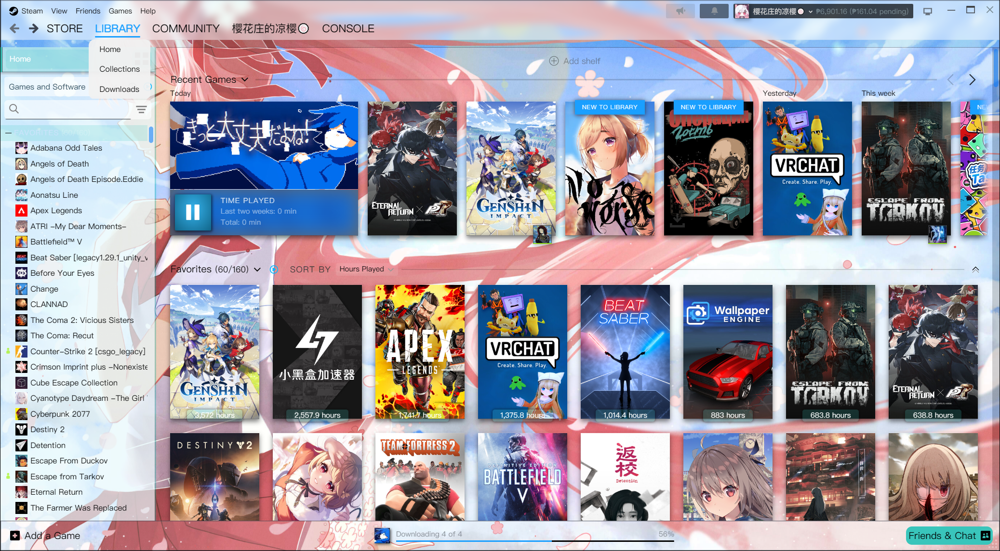
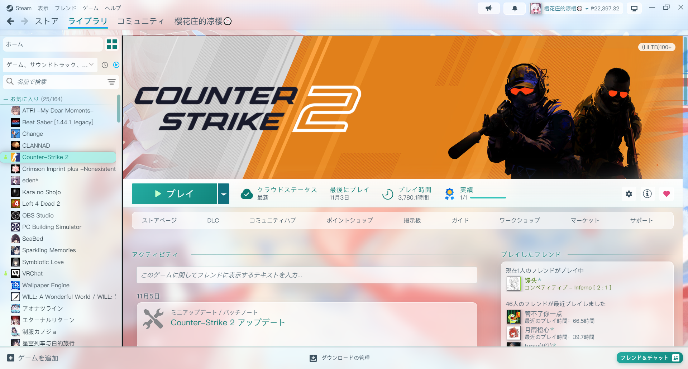
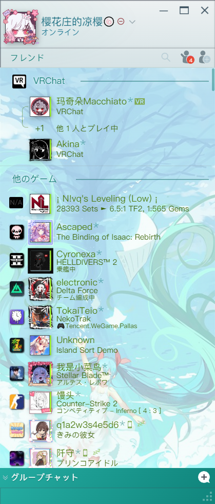
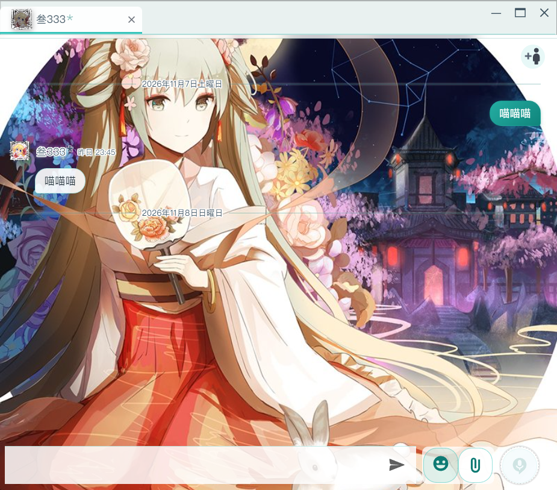
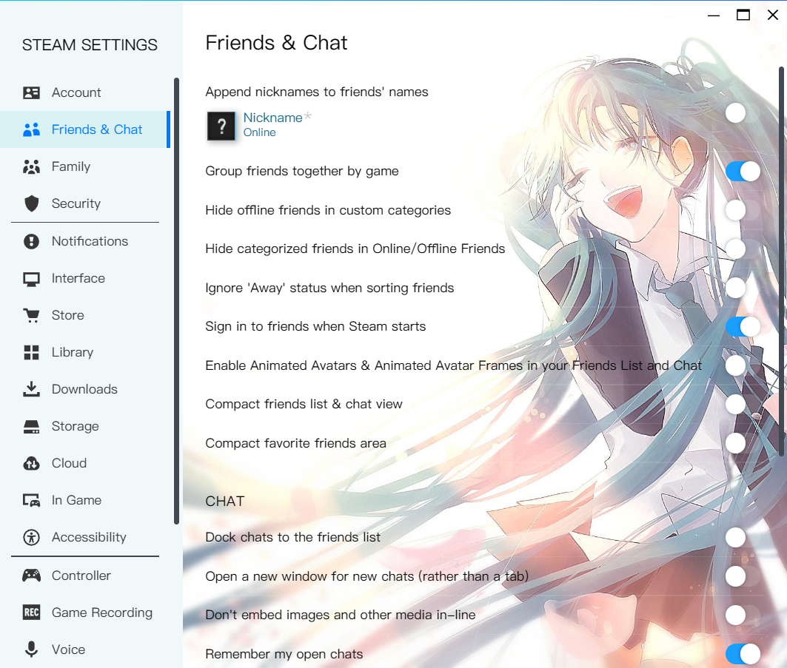
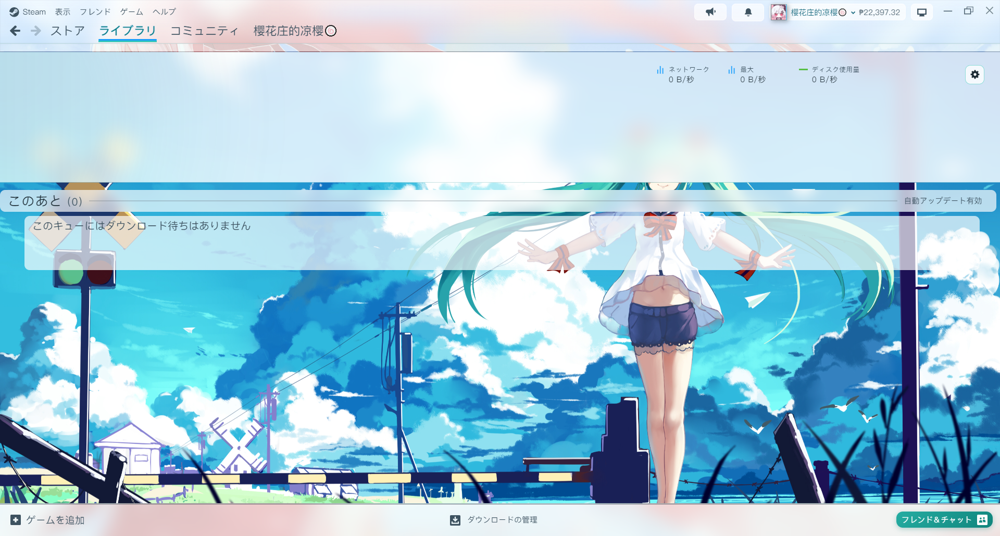

# Threshold-Miku Light

[English](README.md) | **简体中文** | [日本語](README_ja.md)

> 一款以初音未来为主题的 Steam 亮色皮肤，支持 [SFP](https://github.com/PhantomGamers/SFP) 和 [Millennium](https://steambrew.app/)。

---

## 预览

### 游戏库


### 游戏详情


### 好友列表 & 聊天
| 好友列表 | 聊天窗口 |
|----------|----------|
|  |  |

### 设置页面


### 下载页面


---

## 简介

Threshold-Miku Light 是一款适配 Steam 客户端的亮色系主题皮肤，以 **初音未来** 的经典青绿配色（`#39C5BB`）为主调，将 Steam 默认的深色 UI 改造为清新明亮的轻透明风格。皮肤覆盖游戏库、游戏详情、收藏夹、下载、好友列表、聊天窗口、设置页面和各种菜单，全部由 CSS 实现（不再需要 JavaScript 动态注入）。(转人工)

---

## 使用方法

### 前置要求

- [SFP](https://github.com/PhantomGamers/SFP) — Steam 皮肤加载器（支持 CSS/JS 注入）
- [Millennium](https://steambrew.app/) — 也可以用：`skin.json` 按 Millennium 的格式写了明确的加载规则，两边通用（我本人一直在用的是 SFP）

### 安装步骤

1. 从 [Releases](https://github.com/yingzeliangzi/Threshold-Miku-Light/releases/latest) 下载最新的 `Miku.zip`，解压得到 `Miku` 文件夹，放入 Steam 皮肤目录（已装旧版的直接覆盖）：
   ```
   Steam\steamui\skins\
   ```
2. 打开 SFP → Settings → Steam Skin → 选择 **Miku**（如果是 Millennium 则选择**Threshold-Miku-Light**)。
3. 勾选 **注入CSS**（**注入Javascript** 可选，皮肤的 JS 文件目前是空的）。
4. 完全退出 Steam（Steam → 退出）后重新打开。

### 文件结构

```
Miku/
├── skin.json               # SFP / Millennium 共用：每个窗口加载哪个 CSS，以及主题库展示信息
├── global.css              # 配色变量、字体、鼠标指针、滚动条
├── libraryroot.custom.css  # 设置窗口和各种弹出对话框的入口（引用 settings.css）
├── css/
│   ├── steam.css           # 主界面：顶栏、游戏库、游戏详情、收藏夹、下载、底栏
│   ├── dialogs.css         # 对话框、设置行、开关、按钮（steam.css 和 settings.css 共用）
│   ├── settings.css        # 设置窗口及其它弹出对话框
│   ├── login.css           # 登录窗口：选择账户、登录表单、正在登录
│   ├── friends.custom.css  # 好友列表 & 聊天窗口
│   ├── menus.css           # 所有弹出菜单（Steam/表示/右键菜单/通知/托盘）
│   ├── supernavs.css       # 顶部导航悬停菜单（引用 menus.css）
│   ├── webkit.css          # 商店 / 社区网页：透明背景 + 薄纱
│   └── store.steampowered.com.css
├── js/                     # 目前为空（原来的内联样式注入已改为纯 CSS）
├── tools/                  # 维护工具，见下方「维护」一节（不影响皮肤本身）
├── fonts/
│   └── PingFang SC.ttc     # 全局字体
└── imgs/
    ├── mainBG.jpg          # 游戏库主背景
    ├── friendsBG.jpg       # 好友列表背景
    ├── chatBG.jpg          # 聊天窗口背景
    ├── loginBG.jpg         # 登录页背景
    ├── settingsBG.jpg      # 设置页背景
    ├── downloadBG.jpg      # 下载页背景
    ├── musicBG.jpg         # 音乐页背景
    └── cursor.png          # 自定义鼠标指针
```

---

## 美化内容一览

### 全局
| 项目 | 说明 |
|------|------|
| 字体 | 全局替换为 **PingFang SC**，Fallback 为 Segoe UI / Microsoft YaHei (你们不觉得苹方很好看吗) |
| 鼠标指针 | 自定义 PNG 指针 |
| 滚动条 | 细化(6px)、圆角、半透明青色 |
| 配色主调 | 初音官方色 `#39C5BB` 负责可点击 / 选中的东西，樱花粉只做少量点缀 |
| 分区标题 | 统一为「文字 + 向右渐隐的细线」，不使用左侧色条（那种做法是典型的 AI 生成风格） |
| 面板 | 接近纯白的毛玻璃（半透明白 + 模糊），文字为中性深色 `#1b2a33`，让背景图保持自己的颜色 |

配色参考了 [colorany.com 的 Miku 配色](https://colorany.com/color-palettes/miku-color-palettes/)：

| 色值 | 用途 |
|------|------|
| `#39C5BB` | 图标、进度条、勾选框 |
| `#26ada2` → `#12857c` | 按钮渐变（开始、好友、自己的聊天气泡、菜单悬停），白字仍看得清 |
| `#0f7a73` | 青色文字（`#39C5BB` 在白底上对比度只有 2.1，不能直接当文字色） |
| `#A2EFE8` | 悬停、选中的浅青高亮（来自 “Vibrant Miku Blues and Teal Harmony”） |
| `#FFB2C8` | 樱花粉点缀：「ライブラリに新規追加」/「新着」角标、文字选中色 |
| `#F2FBFA` | 毛玻璃、薄纱的底色（几乎是白色） |
| `#1b2a33` / `#3d5260` / `#5b6f7b` | 正文 / 次要文字 / 说明文字 |

所有颜色都在 `global.css` 的 `:root` 里定义，想换配色只改这里即可（其它 CSS 都通过 `var(--miku-...)` 或 `rgba(var(--miku-...-rgb), 透明度)` 引用）。

### 游戏库
| 项目 | 说明 |
|------|------|
| 主背景 | `mainBG.jpg` 全页铺底，各面板透明叠加 |
| 顶栏 / 底栏 | 浅色毛玻璃；账户名、余额、通知按钮改为浅底深字 |
| 地址栏 | 商店 / 社区页面上方的网址栏改为浅色毛玻璃 + 深色网址和图标（原版为黑色）；鼠标停在网址或刷新按钮上时显示白色玻璃胶囊 |
| 商店 / 社区页面 | 原版深蓝底改为透明，透过一层深青色薄纱看到背景图，白色文字依旧清晰（薄纱浓度为 `css/webkit.css` 开头的 `--miku-web-veil`） |
| 左侧边栏 | 浅青色毛玻璃 |
| 收藏夹标题行 | 深青色粗体名称 + 下方向右渐隐的细线 |
| 游戏选中 | 圆角浅青底 + 深青色粗体 |
| 游戏悬停 | 浅青高亮 |
| 货架标题 | 文字加白色描边，直接压在背景图上也清楚；右侧是 Steam 自带的细线 |
| 最近游戏 | 第一款游戏下方的游戏时长栏改为浅色玻璃 + 深色字；下载 / 开始按钮为初音青 |
| 游戏时长标签 | 白色胶囊 + 深色字，深浅封面上都清楚 |
| What's New | 已隐藏 (没有人会喜欢这个What's New吧!!!) |

### 游戏详情
| 项目 | 说明 |
|------|------|
| 开始按钮 | 初音青渐变 + 白色粗体字 |
| 信息栏 | 浅色毛玻璃，标签为深青色 |
| 卡片 | 好友、实绩、DLC、创意工坊等都是浅色玻璃卡片；动态区每条动态（含发行商新闻）单独成卡 |
| 新闻全文 | 点开新闻后的文章页：白色玻璃面板 + 深色正文，背后的遮罩改为浅色模糊；文中的商店卡片、点赞 / 投稿 / 共有按钮同样改为浅色 |
| 安装按钮 | 未安装时的「インストール」为偏蓝的初音青，与「プレイ」区分 |
| 整页底色 | 只有**一层** 38% 的模糊薄纱，背景图清晰可见；卡片再叠一层，卡片里不再叠第三层 |

### 收藏夹 / 下载
| 项目 | 说明 |
|------|------|
| 收藏夹页 | 标题改为玻璃胶囊，「新建收藏」改为虚线玻璃卡片 |
| 单个收藏夹 | 原版深蓝底改为和游戏详情一样的模糊薄纱，背景图可见；标题后为细线，排序下拉框为白色；滚动时吸顶的分区标题为毛玻璃 |
| 封面悬停卡片 | 鼠标停在游戏封面上弹出的详情卡片改为浅色薄雾 + 该游戏自身的色调，圆角、深色文字、青色「游戏时间」标题（原版为深灰蓝） |
| 下载页 | `downloadBG.jpg` 铺满整页，顶部速度区为毛玻璃，下方队列透明露出背景图 |

### 好友列表
| 项目 | 说明 |
|------|------|
| 背景 | `friendsBG.jpg` + 一层浅色薄纱 |
| 好友条目 | 透明，悬停时出现圆角浅青高亮 |
| 分组标题 | 深青色粗体 + 向右延伸的细线 |
| 状态颜色 | 在线 / 游戏中 / 离线均使用在浅色底上可读的深色版本 |
| 群组聊天栏 | 初音青渐变 |

### 聊天窗口
| 项目 | 说明 |
|------|------|
| 背景 | `chatBG.jpg` 独立背景，与好友列表分离 |
| 消息气泡 | 他人消息：白色圆角气泡；自己消息：青绿渐变气泡 |
| 发言人 | 名字和时间加白色描边（像字幕一样），不加底色也能在背景图上看清；名字按在线 / 游戏中状态着色 |
| 标签栏 | 选中标签白底 + 青色底边 |
| 工具栏按钮 | 表情、附件、语音按钮统一为白色圆角卡片 + 青绿图标 |
| 输入框 | 白色半透明背景 + 青绿边框 |

### 设置页面 / 对话框
| 项目 | 说明 |
|------|------|
| 背景 | `settingsBG.jpg` 背景图 |
| 设置项 | 白色半透明卡片 + 深色文字（原版为深灰卡片） |
| 开关 / 单选按钮 | 打开状态为初音青 |
| 对话框 | 浅蓝背景 + 深色字体 + 青绿按钮，遮罩层改为半透明毛玻璃 |
| 安装对话框 | 安装位置列表为白色卡片，选中的磁盘为浅青底 + 青色边框 |
| 下拉列表 | 浅色玻璃列表 + 浅青高亮（原版为深灰），例如 设置 → 存储空间 的磁盘选择 |
| 录像与截图 | 浅色毛玻璃顶栏 + 白色玻璃按钮（当前视图为青色）；游戏 / 媒体选择列表、会话视图和截图查看器也都改为浅色（原版为深灰蓝） |

### 登录窗口
| 项目 | 说明 |
|------|------|
| 背景 | 与游戏库相同的背景图 + 浅色薄纱，从她的脸缓缓飘过发丝（原版为深色游戏封面墙） |
| 选择账户 | 白色圆角头像框，悬停时青色描边；「…」更多按钮改为头像右上角的小圆点，不再挡住头像 |
| 添加账户 / 登录表单 | 深色面板改为毛玻璃：白色圆角输入框 + 青色聚焦光圈，青色登录按钮，二维码放在白色圆角卡片里；Steam 令牌验证码和确认页面同样配色 |
| 正在登录 | 状态文字、头像旁的昵称改为深色，在浅色背景上看得清 |

### 菜单
| 项目 | 说明 |
|------|------|
| 所有弹出菜单 | 浅色玻璃 + 圆角 + 细分隔线，悬停为初音青渐变 |

---

## 已修复的问题

- 库-左侧列表 收藏夹名称为白色字体，与底色混合看不清
- 库-左侧列表 收藏夹名称的上面一款游戏底色被额外添加了底色（原因：旧 JS 把每个收藏夹的最后一款游戏 `LastInCollection` 当成选中项上色）
- 库-左侧列表 选中的游戏没有高亮（原因：旧 JS 给每一行都加了 `background: transparent !important`）
- 库-游戏详情 PLAY 为青色字体，与底色混合看不清
- 库-游戏详情 右侧卡片、动态区、实绩进度等文字颜色
- 库-游戏详情 白色底层叠太多（最多 4 层，接近不透明），背景图几乎看不见
- 库-游戏详情 「i」信息按钮图标是空白的；「全部实绩已解锁」的奖章盖住文字（Steam 自身的样式冲突）
- 库-游戏详情 创意工坊卡片为深色底，两个按钮的文字看不清；「回到顶部」按钮为 Steam 默认深蓝
- 库-游戏详情 发行商新闻（带图片的新闻卡片）和「大型アップデート」卡片为深灰底 + 浅灰字，几乎看不见；大型更新左侧的蓝色标记条改为初音青
- 库-游戏详情 点开新闻后整页变成 Steam 的深色样式；点赞 / 点踩 / 共有图标在浅色按钮上不可见
- 库-左侧列表 收藏夹标题左边的折叠图标看不见
- 库-主页内容区、下载页顶部的深色底块
- 商店 / 社区 页面上方的地址栏为黑色底
- 商店 / 社区 鼠标停在地址栏的网址上会变成深色胶囊，文字看不清；网页本身完全没有加载皮肤样式，因为它的加载规则在 SFP 下从未匹配
- 安装对话框 安装位置列表未选中的磁盘为深灰底 + 深色字，选中的为 Steam 蓝
- 收藏夹 点进单个收藏夹后整页为深蓝底，排序下拉框看不清
- 收藏夹 鼠标停在游戏封面上弹出的详情卡片为深灰蓝；滚动时吸顶的分区标题变成一条深色带，文字看不清
- 聊天窗口 对方的名字和时间直接压在背景图上看不清；标签栏发灰；日期分隔线文字看不清
- 登录窗口 选择账户时「…」更多按钮盖住整个头像，点不到账户；「正在登录」和昵称为白字配浅色背景
- 登录窗口 添加账户的表单（账户名 / 密码 / 二维码）完全是 Steam 的深色样式
- 设置-存储空间 选择磁盘的下拉列表仍是深色，磁盘名是白字配白色底条
- 录像与截图 顶栏、工具栏按钮、游戏选择列表和会话视图都是 Steam 的深色样式，标题和按钮文字是深色配深色；滚动时缩略图在顶栏和底栏下糊成一条灰带
- 设置 / 游戏属性 左侧选中项的青色竖条改为圆角浅青底
- 好友列表 点开搜索后的输入框为深灰外框 + 黑色内阴影，清空文字后依旧保持这个样子；之后「フレンド」标签会被挤成两行
- 设置-所有页面 设置项为深灰卡片配黑色文字，完全看不清
- 好友列表 每行叠加白色底块，杂乱
- 菜单 灰底 + 亮蓝悬停，与主题不搭

所有选择器都已对照当前 Steam 版本核对（498 个乱码 class 全部有效），并在 CSS 注释里标注了 Steam 源码中的可读名称。

---

## 维护：Steam 更新后

Steam 用 CSS Modules 打包界面，所以 class 名是 `_3x1HklzyDs4TEjACrRO2tB` 这样的乱码，而且每次大更新都可能变。但 Steam 的 JS 里仍然保存着「可读名 → 乱码」的对照表（比如 `Container → _3x1HklzyDs4TEjACrRO2tB`），`tools/` 里的工具就是通过 CEF 调试端口把它读出来。

**准备**

1. 在 Steam 安装目录（`Steam\`）新建一个空文件 `.cef-enable-remote-debugging`，重启 Steam。此后 Steam 会在 `localhost:8080` 开放调试端口。
2. 安装 [Node.js](https://nodejs.org/) 22+ 和 Python 3（对比度扫描还需要 `pip install pillow`）。

**Steam 更新后皮肤某些地方失效时**（在 `tools/` 目录下运行）

```bash
python steamclass.py export            # 从运行中的 Steam 导出对照表
python steamclass.py check             # 列出皮肤里已失效的 class
python steamclass.py migrate           # 根据快照推算新 class 名（先预览）
python steamclass.py migrate --write   # 确认无误后写入 css/ 和 js/
python steamclass.py snapshot          # 记录新状态，供下次更新使用
```

`migrate` 的原理：`selectors.snapshot.json` 记录了皮肤用到的每个 class 的可读名，以及它所在模块的其它 class 名。更新后，工具找到可读名相同、且同模块 class 名最相似的那个新模块，从而得到新乱码。

> Steam 是按需加载界面代码的。如果 `check` 报告某些 class 缺失，先在 Steam 里打开相关页面（游戏详情、下载、设置等），再重新 `export`。

**查询与排查**

```bash
python steamclass.py hash _1LJqx_qFOC8199RBQO5kU8     # 乱码 -> 可读名（LibraryItemBoxSubscript）
python steamclass.py name PlayButton                  # 可读名 -> 乱码
python uicheck.py contrast "^Steam$"                  # 找出主窗口里对比度不足、看不清的文字
python uicheck.py dark "^Steam$"                      # 找出浅色主题里的深色底块
python uicheck.py outline "^Steam$" "._3vCzSrrXZzZjVJFZNg9SGu" 3   # 带可读名的 DOM 结构
node cdp.mjs list                                     # 列出所有 Steam 窗口标题
node cdp.mjs "^Steam$" reloadcss                      # 改完 CSS 后不重启 Steam 直接刷新
```

窗口参数是窗口标题的正则，例如主窗口 `^Steam$`、好友列表 `フレンドリスト`（英文客户端为 `Friends List`）、设置 `Steam設定`。截图类命令需要窗口处于显示状态（未最小化）。

---

## 致谢

- 灵感来源：[Threshold-Miku by Jack-Myth](https://github.com/Jack-Myth/Threshold-Miku) (在Steam更改为Chromium内核之前一直在使用的皮肤，时隔接近3年，特此还原)
- 框架来源：[blueArchiveSteamSkin by EugeneXXXie](https://github.com/EugeneXXXie/blueArchiveSteamSkin)
